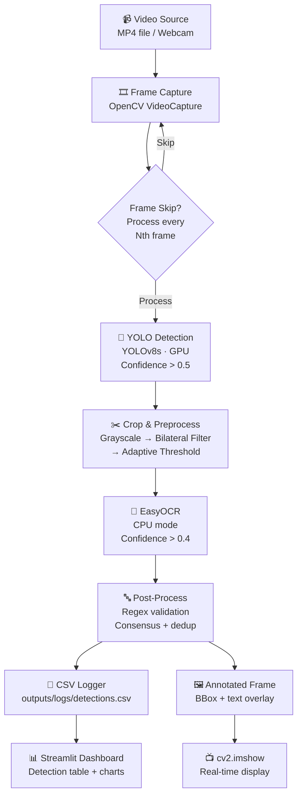

# 🚗 Real-Time Indian License Plate Recognition

Automatic License Plate Recognition (ALPR) system — **YOLOv8** plate detection
+ **EasyOCR** text extraction, tuned for Indian plates
(`SS DD LL NNNN`, e.g. `MH 12 AB 1234`).

Real-time detection from video files or webcam, format validation, temporal
deduplication, CSV logging, and an interactive Streamlit dashboard — running
locally on an RTX 4050 (6GB). Fine-tuned detection reaches **mAP@50 = 0.967**
on the Kaggle Indian plate test split.

**Step-by-step setup & run guide below.** Developer file index in
[Project Structure](#-project-structure).

---

## ✨ Features

- Real-time license plate detection from `.mp4` files or webcam
- Indian plate format recognition and regex validation (`SS DD LL NNNN`)
- EasyOCR text extraction (CPU) — YOLO keeps the GPU, no VRAM contention
- Multi-frame consensus: each plate's most confident reading is logged once
  per time window, instead of every noisy per-frame variant
- Positional digit/letter correction (4↔A, 0↔O, 1↔I, …) against the plate layout
- Interactive Streamlit dashboard with live stats and filters
- Progressive accuracy: works Day 1 on pre-trained weights, ~0.97 mAP@50 after
  a free Colab fine-tune on the Kaggle Indian plate dataset

## 🏗️ Architecture



Training happens once on **Google Colab (free T4)**; inference runs locally.
EasyOCR is pinned to CPU so the 6GB of VRAM stays with YOLO.

## ⚙️ Tech Stack

| Layer | Package | Purpose |
|-------|---------|---------|
| Detection | `ultralytics` (YOLOv8s) | Plate detection — GPU inference |
| OCR | `easyocr` | Plate text extraction — CPU |
| Vision | `opencv-contrib-python` | Frame capture, preprocessing, display, CSRT tracking |
| GPU | `torch` + CUDA | Accelerated inference (local) + training (Colab) |
| Data | `numpy`, `pandas` | Array ops, CSV logging |
| Viz | `matplotlib`, `seaborn` | Evaluation charts, benchmarks |
| Dashboard | `streamlit` | Interactive detection dashboard |
| Dataset | `kagglehub`, `kaggle` | Dataset download |
| OCR (alt) | `pytesseract` | Comparison engine (`scripts/ocr_ab_test.py`) |
| Config | `pyyaml` | YAML configuration |
| Testing | `pytest` | Unit tests (23, no GPU needed) |

## 🚀 Setup

### Prerequisites

- Windows 10/11 + NVIDIA GPU (≥6GB) — CPU works but won't hit real-time FPS
- ~10GB free disk (torch+CUDA ~3GB, dataset ~1GB, models ~1GB)
- Python **3.12** (3.13+ has no ML wheels yet)

### Environment

From the project root:

```powershell
py -3.12 -m venv .venv
.venv\Scripts\activate          # prompt must show (.venv)
python -m pip install --upgrade pip
```

**Install CUDA PyTorch FIRST** (the PyPI wheel is CPU-only on Windows):

```powershell
pip install torch torchvision --index-url https://download.pytorch.org/whl/cu124
```

Then the rest:

```powershell
pip install -r requirements.txt
```

Verify the GPU (must print `True` + your GPU name):

```powershell
python -c "import torch; print(torch.cuda.is_available(), torch.cuda.get_device_name(0))"
```

Optional — Tesseract, only for the OCR comparison script:

```powershell
winget install UB-Mannheim.TesseractOCR
```

### Model weights

The pipeline needs `models\best.pt`:

- **Pre-trained (Level 0, ~79% mAP@50):** download a YOLOv8 license-plate
  `best.pt` — sources in [`models/README.md`](models/README.md)
- **Fine-tuned (Level 1, ~97% mAP@50):** produced by the Colab notebook
  (see [Fine-Tuning](#-fine-tuning-the-model-level-1)) — place at `models\best.pt`

Without it, the pipeline exits with a message pointing to `models/README.md`.

### Dataset (optional)

Needed only for training and image benchmarks:

```powershell
python src\train.py --download
```

Downloads via `kagglehub` — no Kaggle API token needed. Lands in
`data\raw\License Plate Detection\` (15,338 images, native YOLO format).

## 🎬 Running the pipeline

```powershell
python scripts\run.py --source path\to\video.mp4
python scripts\run.py --source 0          # webcam
python scripts\run.py                     # uses video.source from the config
```

- A live window opens with green boxes on every detected plate; plates whose
  text validated also show the recognized string + confidence. Press **q** to quit.
- `--no-display` skips the preview window (frames still saved when
  `output.save_annotated_frames` is enabled).
- Valid readings append to `outputs\logs\detections.csv` — one row per plate
  per 3-second window (the highest-confidence reading in that window).
- Console prints FPS every 30 processed frames. Expect ~1.5–5 FPS end-to-end
  (EasyOCR on CPU is the bottleneck; detection alone runs at ~150 FPS).
- First run downloads EasyOCR models (2–5 min, one time only).

## 📊 Dashboard

In a second terminal (same venv):

```powershell
python -m streamlit run dashboard\app.py
```

Opens at `http://localhost:8501`: headline metrics, detections-over-time,
searchable detection log, confidence distribution, top plates. Toggle
**Auto-refresh** in the sidebar to tail the live log while the pipeline runs.

## 🧪 Image benchmarks

```powershell
python scripts\test_images.py --num 150 --seed 7 --save-csv
```

Picks random test-split images, runs detection + OCR, saves annotated JPGs to
`outputs\visualizations\`, appends valid plates to the CSV. Same `--seed` =
same images — the standard before/after protocol.

Performance charts (FPS vs threshold, latency breakdown, heatmaps):

```powershell
python scripts\benchmark.py --video data\sample_video.mp4
```

## 🏋️ Fine-tuning the model (Level 1)

**Google Colab (recommended — free T4, ~1.5–3h):**

1. Upload `notebooks\02_training.ipynb` to [Colab](https://colab.research.google.com)
2. `Runtime → Change runtime type → T4 GPU`
3. Run all — approves Drive mount, downloads the dataset via kagglehub
   (no API token), trains YOLOv8s (batch 16, 80 epochs, early stopping)
4. `best.pt` lands in Google Drive → download → place as `models\best.pt`

**Local fallback** (auto-scales batch to your VRAM):

```powershell
python src\train.py --download      # dataset into data\raw\
python src\train.py                 # train
```

## 🎯 Evaluation

```powershell
python -c "from ultralytics import YOLO; r = YOLO('models/best.pt').val(data='data/raw/License Plate Detection/data.yaml', split='test'); print(r.box.map50, r.box.map)"
```

Detailed curves, confusion matrix, and latency breakdown:
[`notebooks/03_evaluation.ipynb`](notebooks/03_evaluation.ipynb).

## 📈 Results

Measured on the Kaggle test split (1,534 images / 1,955 plates) and a 10.7s
1080p street video on an RTX 4050 Laptop:

| Metric | Pre-trained | Fine-tuned | Target |
|--------|------------|------------|--------|
| Detection mAP@50 | 0.789 | **0.967** | ≥ 0.85 ✅ |
| mAP@50-95 | 0.341 | **0.790** | — |
| Recall | 0.718 | **0.918** | — |
| Plates found (150-image sample) | 154 | **188** | — |
| Format-valid readings (same sample) | 21 | **32** | — |
| Detection-only speed | 8.4 ms/image (~150 FPS) | same | ≥ 15 FPS ✅ |

OCR remains the accuracy bottleneck: ~17% of detected plates produce a
format-valid string on hard crops (dusk motion blur, frame-edge plates). The
engine comparison on identical crops: EasyOCR 17.3% valid vs Tesseract
(psm 7 + whitelist) 10.7% vs Tesseract+Otsu 6.1% — EasyOCR is ~3× slower per
read, hence the CPU-bound pipeline speed.

## 🔧 Configuration

All knobs live in [`config\config.yaml`](config\config.yaml):

| Key | What it does |
|-----|--------------|
| `video.source` | Video path or `0` for webcam |
| `video.frame_skip` | `1` = every frame (slow, max coverage); `2+` for long videos |
| `video.resize_width/height` | `null` = native resolution (recommended — OCR gets 2× pixels, FPS unchanged) |
| `video.use_tracker` | CSRT box propagation on skipped frames |
| `detection.confidence_threshold` | YOLO threshold (0.5) |
| `ocr.gpu` | **Keep `false`** — EasyOCR on CPU; YOLO owns the GPU |
| `postprocess.consensus*` | Multi-frame best-reading tracking + emit window |
| `postprocess.positional_correction` | Digit/letter confusion repair (max 1 fix) |
| `postprocess.dedup_window_seconds` | Repeat-suppression window |
| `output.save_annotated_frames` | Save annotated JPGs per processed frame |

## 🧯 Troubleshooting

| Symptom | Cause → Fix |
|---------|-------------|
| `import torch` works but `cuda.is_available()` is `False` | CPU-only wheel installed → install torch from the cu124 index URL (see Setup) |
| `streamlit: not recognized` in PowerShell | Wrong venv — prompt must show `(.venv)`; or run `.venv\Scripts\python.exe -m streamlit run dashboard\app.py` |
| `RuntimeError: CSRT tracker is unavailable` | Base `opencv-python` 5.x dropped trackers → `pip install opencv-contrib-python` (or set `video.use_tracker: false` — the pipeline degrades gracefully) |
| `Model weights not found at 'models/best.pt'` | Download weights (see Model weights) |
| `Kaggle API token not found` (only `train.py --download`) | The Colab notebook needs no token; for the local CLI place `kaggle.json` in `~\.kaggle\` |
| `No images found under data\raw` | Dataset not downloaded → `python src\train.py --download` |
| EasyOCR downloads models on first run | Normal — 2–5 min, one time only |
| `CUDA out of memory` | Keep `ocr.gpu: false`; don't train locally with Colab-sized batches |
| OCR misses clearly visible plates | Expected on dusk/blur/frame-edge crops — levers: Tesseract fallback on empty reads, PaddleOCR, lower `frame_skip` |

## 📁 Project Structure

```
Runtime flow:
  scripts/run.py ─► src/pipeline.py ─► detect ─► preprocess ─► ocr ─► postprocess ─► utils (CSV)
                        │                │                        │
                        ├─ src/tracker.py (CSRT, skipped frames)  └─ src/visualize.py (overlays)
                        └─ config/config.yaml
```

| Path | Contents |
|------|----------|
| `config/config.yaml` | Single source of truth: video, detection, OCR, preprocess, postprocess, training, output, dashboard |
| `src/pipeline.py` | `ALPRPipeline` orchestrator: video loop, frame skip, consensus/dedup gating, CSV logging, display |
| `src/detect.py` | `PlateDetector` (YOLOv8) + `Detection` dataclass |
| `src/ocr.py` | `PlateOCR` (EasyOCR, CPU-forced) |
| `src/preprocess.py` | `preprocess_plate` — grayscale/bilateral/threshold/resize chain, all config-gated |
| `src/postprocess.py` | `clean_plate_text`, `validate_plate`, `correct_plate_format`, `PlateConsensus`, `TemporalDeduplicator`, `RecognitionResult` |
| `src/tracker.py` | `PlateTracker` (CSRT), `csrt_available()` guard |
| `src/visualize.py` | `draw_results` — styled overlays (boxes, labels, tracker outlines, FPS) |
| `src/train.py` | Dual-mode training (local VRAM tiers / `--colab`), Kaggle download, `best.pt` handling |
| `src/utils.py` | `load_config`, `setup_csv_logger`, `log_detection`, `get_timestamp` |
| `scripts/run.py` | CLI entry point (`--source`, `--config`, `--no-display`) |
| `scripts/test_images.py` | Detection+OCR benchmark on dataset images |
| `scripts/benchmark.py` | FPS/latency/heatmap chart generator |
| `scripts/ocr_ab_test.py` | EasyOCR vs Tesseract comparison on identical crops |
| `dashboard/app.py` | Streamlit dashboard |
| `notebooks/01_data_exploration.ipynb` | Dataset analysis |
| `notebooks/02_training.ipynb` | Colab fine-tune (produced the Level 1 weights) |
| `notebooks/03_evaluation.ipynb` | mAP/PR/confusion/latency evaluation |
| `tests/test_pipeline.py` | 23 unit tests — all pass without GPU |
| `data/raw/` | Kaggle dataset (downloaded) |
| `models/` | `best.pt` weights + download instructions |
| `outputs/logs/` | `detections.csv` runtime log (+ `archive/` snapshots) |
| `outputs/visualizations/` | Annotated videos, benchmark charts |

## 📋 CSV schema

`outputs/logs/detections.csv` — 9 columns:

`timestamp` (ISO 8601) · `frame_no` · `plate_text` · `ocr_confidence` ·
`det_confidence` · `bbox_x1` · `bbox_y1` · `bbox_x2` · `bbox_y2`

## 🤝 Contributing

1. Run the tests: `python -m pytest tests/ -v` (no GPU needed)
2. Keep paths in `config/config.yaml` — no hardcoded paths in code
3. Match the existing docstring style; public functions document their config keys

## 📝 License

[MIT](LICENSE)
